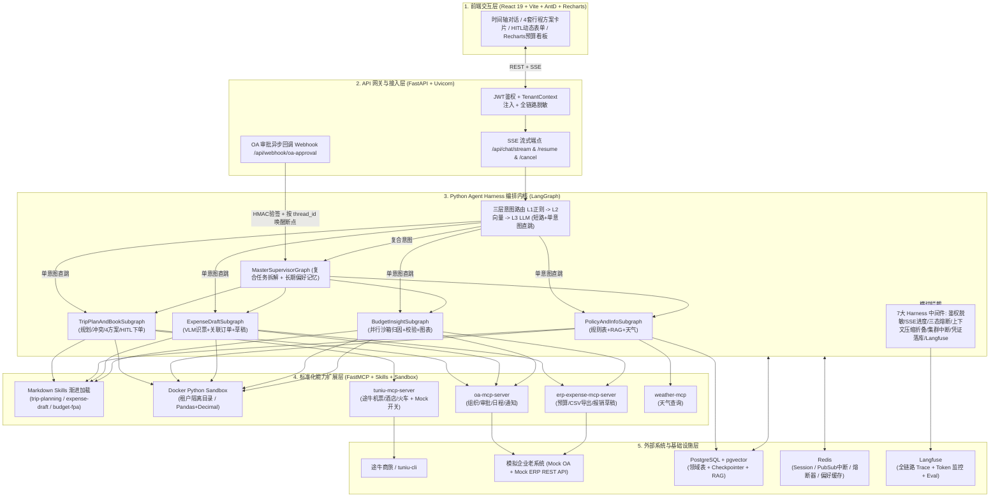
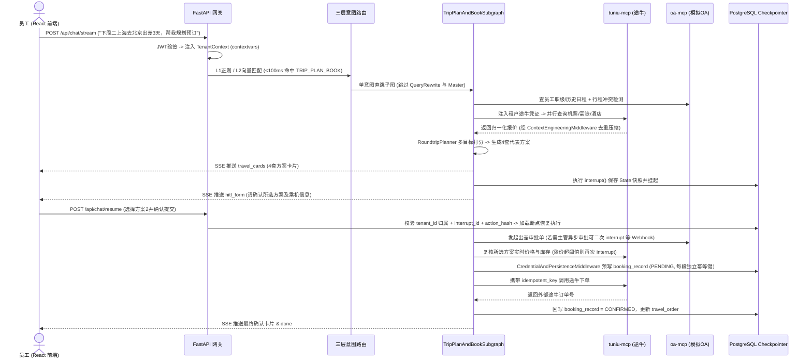

# PyTravel-Harness：企业级多智能体差旅协同与预算归因分析系统 — 需求与架构设计文档

> **文档版本**：v1.1（已完成一轮设计评审优化，全部变更点与原因见文末「十一、v1.1 设计评审优化记录」，正文中以“v1.1”标注）
>
> **文档用途**：作为新开独立项目文件夹的完整工程蓝图（PRD + 架构设计 + 数据库 DDL + Harness 中间件规范 + 分阶段开发计划），可直接用于项目初始化、模块开发与简历/面试技术沉淀。
> **核心定位**：基于 **Python 3.12 + FastAPI + LangGraph + FastMCP + Docker Sandbox** 构建的企业级 **Agent Harness** 协同中枢。通过标准 **MCP 协议**打通企业现有 **OA（审批/组织）** 与 **ERP（预算/报销）**，外部机票/酒店/火车预订直接接入**途牛（`tuniu-cli` / `tuniu-mcp`）**，覆盖「差旅申请 → 审批 → 行程规划 → 途牛预订 → 发票报销草拟 → 部门预算执行与超支归因分析」全链路。

---

## 一、 项目背景与核心设计原则

### 1.1 真实企业痛点与系统边界
在真实中大型企业与政企客户中，差旅和报销通常已存在内部老系统（OA 审批、用友/金蝶/SAP 或自研费控 ERP），但企业**不会自研机票/酒店预订系统**，通常对接外部商旅/OTA 渠道（本项目统一对接**途牛**）。传统模式存在三大痛点：
1. **系统孤岛与高人工搬运成本**：员工需在 OA 提申请 → 去途牛查价订票 → 回费控系统手工贴发票填报销单，跨系统操作繁琐。
2. **行程决策复杂且易超标**：机票、酒店、高铁受职级、城市等级、提前预订天数、审批阈值多重约束，人工比价耗时且易触发隐性冲突。
3. **事后缺乏宏观预算洞察与降本抓手**：部门负责人和财务 BP 只能看到静态汇总表，难以快速定位“预算为什么超支（量增还是价升、临期订票溢价多少、高频城市协议酒店能省多少钱）”。

**本系统定位边界**：
* **绝不推翻重造企业老 OA / ERP**，而是作为上层 **Agent Harness 智能协同中枢**，通过 **MCP 协议适配层**解耦对接现有系统与途牛预订能力。
* **坚持“高容错辅助决策 + 确定性计算下沉 + 人工拍板闭环”原则**：
  * **行程规划**：不替员工瞎拍板，输出 **4 套代表方案（最省钱/最省时/最合规/最舒适）** 供员工交互确认；
  * **报销处理**：不做越权扣款或自动入账凭证，定位为**报销单智能草拟助手**（识票 + 关联行程与途牛订单 + 柔性异常提示 + 人工确认提交 ERP）；
  * **预算分析**：数值聚合与量价拆分 **100% 下沉到 Python 沙箱确定性脚本（Pandas + `Decimal`）**，并配 `VerificationNode` 勾稽校验防报告抄错数字；大模型只负责归因解读与高容错的宏观降本策略建议。

---

## 二、 用户角色、RBAC 权限与多租户隔离设计

### 2.1 四大核心用户角色矩阵

| 角色枚举 | 角色名称 | 核心业务诉求与可用功能 | 数据可见范围 | 写操作权限（HITL 控制） |
| :--- | :--- | :--- | :--- | :--- |
| **`EMPLOYEE`** | 普通员工 | 差旅政策问答、多目标行程规划、途牛比价下单、查看个人订单、上传发票自动草拟报销单 | **仅本人**的差旅单、途牛预订记录、报销草稿、个人偏好记忆 | 提交差旅申请、途牛确认下单、提交报销草稿（均需本人 HITL 确认） |
| **`DEPT_MANAGER`** | 部门负责人 / 主管 | 包含 `EMPLOYEE` 全部能力 + 查看/审批本部门出差申请 + **本部门及下属团队预算执行与超支归因分析** | **本人 + 本部门及下属子部门**脱敏汇总与明细（严禁跨平行部门查账） | 审批通过/驳回差旅单、确认发送本部门超支预警通知 |
| **`FINANCE_ADMIN`** | 财务 BP / 行政管理层 | **全租户跨部门预算执行全景分析**、超支归因与协议酒店降本测算、维护本租户差旅政策规则与预算额度 | **本租户全公司**预算与脱敏差旅消费数据 | 配置预算/预警阈值、发送全公司/部门级预警与差标调整建议（需 HITL 确认） |
| **`TENANT_ADMIN`** | 租户/交付管理员 | 配置本租户 OA/ERP MCP 连接、配置途牛企业凭证、管理业务 `SKILL.md`、查看 Langfuse Token 消耗与 Eval 报告 | 本租户配置元数据与可观测审计日志（敏感字段脱敏） | 凭证与系统配置管理 |

### 2.2 四层纵深多租户隔离架构（Enterprise Multi-Tenancy）

为支撑软件公司向多个政企/企业客户交付，系统从接入层到沙箱层实现 **4 层强制租户隔离**：

1. **身份认证与异步上下文透传层（`contextvars`）**
   * 网关通过 JWT + Redis Session（类 Sa-Token 机制，支持主动踢下线与续期）解析出不可伪造的 `TenantContext`（v1.1：Session 仅存 `jti → user_id/tenant_id/perm_version`，角色与管辖部门树每次请求由 `sys_dept` 组织树 + 10 分钟权限缓存计算，组织调整或角色变更后无需重新登录即可生效）：
     ```python
     @dataclass(frozen=True)
     class TenantContext:
         tenant_id: str          # 租户隔离主键（所有查询强制绑定）
         user_id: str            # 当前用户ID
         dept_id: str            # 所属部门ID
         managed_dept_ids: tuple[str, ...]  # 主管管辖部门树ID（v1.1：tuple 保证 frozen 真正不可变且可哈希）
         role: Literal["EMPLOYEE", "DEPT_MANAGER", "FINANCE_ADMIN", "TENANT_ADMIN"]
         rank_level: str         # 职级（如 P5/P6/P7/P8，绑定差旅标准）
         rank_no: int            # 职级数值（P5→5），差标区间按数值比较（v1.1）
         trace_id: str           # 全链路追踪ID
     ```
   * 利用 Python 原生 `contextvars.ContextVar`（对标 Java `TransmittableThreadLocal`）在 FastAPI 异步协程、LangGraph 并行节点（`Send`）间透传，杜绝高并发串租户。**v1.1 明确 3 个 `contextvars` 管不到的边界**：
     * **跨进程边界**：MCP Server 是独立进程，`contextvars` 无法跨进程。Harness 调用 MCP 时由中间件签发 60s 有效的**内部服务令牌**（Header `X-PyTravel-Ctx`，载荷含 `tenant_id/user_id/role/managed_dept_ids/trace_id`），MCP Server 验签后重建 `TenantContext` 并**自行做数据权限校验**，绝不信任 LLM 生成的 `tenant_id/dept_id` 参数。
     * **断点恢复边界**：`/resume` 与 OA Webhook 唤醒时不能沿用“当前请求”的上下文（Webhook 根本没有用户 JWT），统一按 `chat_conversation` 的归属（`tenant_id/user_id`）重新加载并构造 `TenantContext`。
     * **线程池边界**：同步工具若经 `loop.run_in_executor` 执行，需显式 `contextvars.copy_context().run(...)`，或改用会自动复制上下文的 `asyncio.to_thread`。
2. **存储与检索隔离层（DB / Checkpointer / RAG / Redis）**
   * **PostgreSQL 领域表**：全表强制包含 `tenant_id` 字段，Repository/ORM 层自动注入 `WHERE tenant_id = :tenant_id`（以及 `DEPT_MANAGER` 的 `dept_id IN (:managed_dept_ids)`）。**v1.1 增加 PostgreSQL 行级安全（RLS）兜底**：每个事务执行 `SET LOCAL app.tenant_id = :tenant_id`，即使某处手写 SQL 漏了 `WHERE` 条件，数据库也只返回本租户数据（应用层过滤 + 数据库层强制，双保险）。
   * **LangGraph Checkpointer**：`thread_id` 强制采用命名空间前缀 `{tenant_id}:{user_id}:{conversation_id}`，校验调用方归属，杜绝跨租户劫持会话断点。
   * **pgvector RAG 知识库**：文档切片 Metadata 绑定 `tenant_id` 与 `doc_scope`（`PUBLIC` / `TENANT`），执行 **Pre-filtering 先过滤后检索**，确保 A 客户绝不会搜出 B 客户的《差旅报销制度》。
   * **Redis Key**：统一为 `pytravel:{tenant_id}:{业务域}:...` 租户前缀；仅登录会话（解析出租户之前）与全局熔断器两类例外（v1.1 与 8.2 表对齐）。
3. **外部凭证隔离层（途牛 API Key / 企业账户）**
   * 各租户/用户的途牛凭证采用 **AES-256-GCM** 加密存储于 `tenant_credential` 表；
   * 执行途牛查询/下单前，由 `CredentialAndPersistenceMiddleware` 按当前 `TenantContext` 动态解密并注入 MCP 调用 Header，**绝不写入 LLM Prompt 或 LangGraph State**，且日志经全链路脱敏拦截器掩码。
4. **沙箱与工作区物理隔离层**
   * 每个会话在 Docker 沙箱内独占隔离目录 `/workspace/{tenant_id}/{conversation_id}/`（v1.1：不再用含冒号且重复包含 tenant_id 的 `thread_id` 作目录名），禁止路径穿越（LLM 只能引用 `artifact_id`，由 Harness 映射为真实路径并做 `realpath` 前缀校验，而非仅过滤 `..`），容器禁公网、限 CPU/内存/执行超时（30s），会话结束后定时清理临时 CSV 与图表文件。

---

## 三、 业务需求与核心功能详述

### 模块 1：智能行程规划与途牛预订全链路（`TripPlanAndBookSubgraph`）
* **自然语言槽位提取与澄清**：支持“下周二从上海去北京出差 3 天，住国贸附近，帮我按公司差标规划并预订”类口语指令；缺少关键要素（出发地/日期/天数）时主动澄清。
* **行程冲突与六维软审核**：
  * 调 `oa-mcp` 校验同员工历史差旅单，检测**时间重叠（同城重复 / 跨城物理不可能）**及跨城衔接合理性，输出 `HIGH / MEDIUM / LOW` 三级风险提示；
  * 对照 `travel_policy_rule` 校验机票舱位、高铁席别、酒店每晚限额、提前预订天数软约束。
* **途牛实时比价与多目标组合优化（`RoundtripPlanner`）**：
  * 调 `tuniu-mcp`（底层封装 `tuniu-cli` / 途牛商旅接口，支持 Mock 开关）检索机票/高铁/酒店实时库存与报价；
  * 通过 `TravelDataNormalizer` 归一化为统一卡片模型，执行**双轨多目标打分**（时间与价格 Min-Max 归一化 + 差标软惩罚 + 个人长期偏好加权），最终输出 **4 套代表方案**：
    1. **极致性价比方案（最省钱）**
    2. **最高效直达方案（最省时）**
    3. **100% 差标合规方案（最稳妥）**
    4. **个人偏好均衡方案（最舒适）**
* **Human-in-the-Loop 下单与审批闭环**：
  * 通过 LangGraph `interrupt()` 挂起，向前端推送 `hitl_form` 交互卡片让用户勾选方案并确认乘机人/入住信息；
  * 用户确认后，自动通过 `oa-mcp` 发起出差审批（支持同步自动批或异步 Webhook 回调唤醒）；
  * **下单前价格/库存复核**（v1.1 新增）：审批可能耗时数小时，途牛报价与余票会变化。恢复执行后先调 `tuniu-mcp` 复核所选方案，若总价上涨超过 `max(50 元, 3%)` 或已售罄，则再次 `interrupt()` 让用户重选/确认新价，**禁止按过期报价静默下单**；
  * 复核通过后按 **“先落库 PENDING → 调途牛下单 → 回写 CONFIRMED/FAILED”** 顺序执行，每个航段/酒店使用独立幂等键（见 7.1），超时未知结果由对账任务通过 `get_booking_status` 补偿，杜绝“途牛已扣款、本地无记录”。

### 模块 2：差旅政策与出行信息双通道问答（`PolicyAndInfoSubgraph`）
* **双通道精准决策**（解决纯 RAG 容易看错职级和城市等级的痛点）：
  * **通道 A（结构化精确查询）**：自动绑定 `TenantContext.rank_level` 查 `travel_policy_rule`（4 职级区间 × 3 城市等级 = 12 条精确红线：舱位、席别、住宿限额、餐补、交通补贴、审批阈值、提前预订天数）。
  * **通道 B（语义检索 + 外部辅助）**：pgvector RAG 检索本租户《差旅管理政策》与《差旅出行指南》，结合 `weather-mcp` 返回目的地天气与穿衣/延误提醒。

### 模块 3：发票识别与报销单智能草拟（`ExpenseDraftSubgraph`，高容错辅助型）
* **多模态发票解析**：员工上传机票行程单、酒店水单、打车/餐饮发票图片（支持批量），调用多模态视觉模型提取发票号、日期、商户名、金额、税额、费用类型。
* **行程与途牛订单自动关联**：自动匹配该员工已完成的 `travel_order` 与 `booking_record`，计算总支出并与差标做柔性对比（标注“住宿超标 80 元，建议填写超标说明”或“缺少交通票据”，**仅辅助提示不越权扣款**）。
* **人工确认与推送 ERP 草稿**：通过 `interrupt()` 弹出预填好的报销明细表单卡片，员工核对修改并补充事由后，调用 `erp-expense-mcp` 推送生成企业 ERP 报销草稿单。

### 模块 4：部门预算执行与超支归因分析（`BudgetInsightSubgraph`，Python 沙箱王炸模块）
面向 **`DEPT_MANAGER`（查本部门）** 与 **`FINANCE_ADMIN`（查全公司）**，解决管理层“钱花哪了、为什么超、怎么省”的核心诉求：
* **安全查数与上下文卸载（Context Offloading）**：按 `TenantContext` 权限调用 `erp-expense-mcp` 导出脱敏差旅消费明细与部门预算表，**直接落盘至当前会话沙箱 CSV**，只向 LLM 返回 `{artifact_id, schema, row_count, sample_5_rows}`（v1.1：以 `artifact_id` 代替真实路径，防止模型构造路径），彻底防止大表撑爆 Token。
* **LangGraph `Send` API 并行 3 路 Pandas 沙箱精算**（v1.1 精度方案：CSV 中金额以字符串导出，读入后转为 **`int64` 分（cent）** 参与向量化计算，仅在输出层转换为 `Decimal` 并按 `ROUND_HALF_UP` 保留 2 位。避免在 Pandas `object` 列里直接存 `Decimal`——这会让 groupby/sum 退化为逐行 Python 运算，且 `mean()` 等操作会被静默转成 float，反而丢精度）：
  1. **路径 A — 预算执行与量价拆分归因**：计算各部门季度预算执行率、超支额、同比/环比，并精确拆解超支原因究竟是**“出差人天/频次上涨（量增）”**还是**“人均单次机酒均价上涨（价升）”**。v1.1 明确采用无残差的两因素分解公式 $\Delta C = (Q_1 - Q_0) \cdot P_0 + (P_1 - P_0) \cdot Q_1$（$Q$ 为出差人次，$P$ 为人次均费用，下标 0 为基期/预算假设、1 为本期），保证“量增效应 + 价升效应 = 总差额”恒成立，可做精确勾稽；
  2. **路径 B — 预订行为与政策偏离归因**：结合 `booking_record.booked_at` 与出发日期，统计**临期订票（提前天数 < 对应差标规则的 `min_advance_booking_days`）占比及机票溢价总额**（v1.1：阈值取自 `travel_policy_rule`，不再硬编码 3 天）、酒店软超标占比；
  3. **路径 C — 高频城市/酒店集中度与降本测算**：识别消费 Top 5 目的地城市与高频酒店/航线，按行业协议折扣模型测算**“签约协议酒店 / 收紧提前预订天数至 5 天”预计可节省的季度预算金额**。
* **确定性勾稽校验节点（`VerificationNode`）**：
  * **“占位符渲染 + 勾稽校验”双保险**（v1.1 优化）：大模型撰写报告时**不直接书写任何指标数字**，只引用占位符（如 `{{dept.D001.exec_rate}}`、`{{total.overspend}}`），由纯 Python 从 `budget_metrics.json` 渲染真实数值与统一格式（万元/百分比），从源头消除抄错数字；
  * `VerificationNode` 再做兜底校验：① 所有占位符均可解析；② 报告中不存在占位符之外的“裸数字”金额/比例；③ 部门名称属于当前权限范围；④ 不变量成立（量增效应 + 价升效应 = 总差额、各部门超支之和 = 汇总超支）。不通过则携带精准 Diff 打回重写（最多 2 次），仍失败则降级为“数据表 + 模板化结论”输出。
* **图表可视化与管理动作 HITL**：
  * 直接输出 **Recharts 3 标准图表 JSON**（部门预算对比柱状图、月度费用趋势折线图、超支归因贡献占比饼图），通过 SSE 推送前端实时渲染；
  * 当某部门执行率超过 `warn_threshold`（如 85%），主动询问是否触发预警，经 `interrupt()` 人工确认后调用 `oa-mcp` 推送预算预警通知并留痕。

### 模块 5：长期记忆、会话体验与异步辅助服务
* **跨会话长期偏好记忆**：自动从历史交互中提炼并更新员工出行偏好（如“偏好国航/东航、酒店优先亚朵/全季、高铁偏好靠窗、拒绝红眼航班”），存入 `user_preference` + 向量索引，并配请求级 Redis 缓存防重复检索。
* **异步轻量服务**：独立异步任务生成精简会话标题（`ConversationTitleService`）与每轮结束后的智能追问建议（`QuestionRecommendationService`）。

---

## 四、 整体系统架构与请求全链路

### 4.1 五层系统架构图



### 4.2 核心请求与 HITL 挂起恢复时序图（以“行程规划 + 途牛预订”为例）



---

## 五、 多智能体编排与三层意图路由细节

### 5.1 三层意图识别短路设计（参考并升级 `gogo-agent`）

| 层级 | 组件名 | 实现机制 | 目标延迟 | 短路与优化策略 |
| :--- | :--- | :--- | :--- | :--- |
| **L1** | `RegexRuleRouter` | 高频关键词与正则规则库（如 `预算\|超支\|归因`、`报销\|发票`、`查政策\|差标`、`出差\|订机票\|订酒店`） | `< 50ms` | 命中高置信单意图 → **跳过 QueryRewrite**，并直接路由至目标子图 |
| **L2** | `VectorIntentRouter` | 文本 Embedding + 内存/pgvector 意图原型库余弦相似度 Top-1（阈值 `>= 0.86`） | `< 100ms` | 命中高置信单意图 → **跳过 QueryRewrite**，单意图直跳目标子图 |
| **L3** | `LLMIntentRouter` | 轻量模型（如 `qwen-turbo` / `deepseek-chat`）Structured Output 单次兜底分类 | `~600ms` | 先按需触发 `QueryRewritingNode` 消解多轮指代；若为复合意图则交由 `MasterSupervisorGraph` |

* 三层输出统一抽象为 Pydantic 模型 `IntentResult(intents: list[str], confidence: float, source: Literal["RULE", "VECTOR", "LLM"], direct_route_target: str | None)`，下游图编排零耦合。
* **短路生效的前置条件**（v1.1 补充，防止“快但错”）：
  1. **会话存在挂起的 HITL 断点或活跃子图时，优先粘性路由回该子图**（如用户在方案卡片后说“就第二个吧”），不进入三层路由；
  2. L1 仅在**恰好命中 1 个意图**时短路；同时命中多个意图关键词（如“订机票顺便看下部门预算”）直接判为复合意图交给 L3 / Master；
  3. 多轮对话中输入含指代/省略（“那个”“换成”“再”“上一个”）时，不跳过 `QueryRewritingNode`；
  4. L2 除绝对阈值 `>= 0.86` 外，还要求 **Top1 − Top2 ≥ 0.05** 的置信间隔，避免两个意图原型相似度接近时误判。

### 5.2 LangGraph 核心 State 定义与子图设计

```python
class BaseAgentState(TypedDict):
    # 消息流（LangGraph 内置 add_messages reducer）
    messages: Annotated[list[BaseMessage], add_messages]
    # 路由与规划状态
    intent_result: Optional[dict]
    plan_steps: list[dict]                # Todo 规划清单（前端实时展示）
    active_subgraph: Optional[str]        # 当前活跃子图（支持断点续跑）
    loaded_skills: list[str]              # 已加载的 Skill 名称（用于历史折叠优化）
    # 沙箱与中间产物（Context Offloading，只存路径不存大文本）
    workspace_dir: str
    artifact_files: Annotated[list[dict], operator.add]  # [{"artifact_id": "...", "type": "csv|png|xlsx", "summary": "..."}]
    # 前端结构化渲染载荷
    travel_options: Optional[list[dict]]  # 4套代表行程方案卡片
    chart_payloads: Annotated[list[dict], operator.add]  # Recharts 3 标准图表 JSON（3 路并行 Worker 同时写入）
    budget_metrics: Annotated[dict, lambda a, b: {**a, **b}]  # 各 Worker 指标按 worker 名合并
    # 安全与成本控制
    step_count: Annotated[int, operator.add]    # 节点返回增量，并行分支可安全累加
    total_tokens: Annotated[int, operator.add]
    verification_feedback: Optional[str]  # VerificationNode 勾稽失败打回的 Diff 信息
    verification_retry_count: int         # 语义化命名，避免与工具重试计数混淆
```

> **v1.1 修正**：`BudgetInsightSubgraph` 通过 `Send` 并行扇出 3 个 Worker，它们在同一个 super-step 内写入 `chart_payloads` / `artifact_files` / `step_count`。LangGraph 中**没有 reducer 的 channel 在同一步被多次写入会直接抛 `InvalidUpdateError`**，因此所有可能被并行写入的字段都必须声明 reducer（`operator.add` 或自定义合并函数）。

### 5.3 核心算法与并行图设计要点
1. **往返行程多目标打分算法（`RoundtripPlanner`）**：
   * 输入：途牛返回的去程交通集合 $F_{out}$、酒店集合 $H$、返程交通集合 $F_{back}$；
   * **分段预裁剪（v1.1 优化）**：先对 $F_{out}$、$H$、$F_{back}$ 各自做硬过滤（时间不可行、硬性超标）并保留 Pareto 前沿 / Top-K（K≈10），再做笛卡尔组合，把候选规模从 $|F_{out}| \times |H| \times |F_{back}|$（可达数十万）压到 $\le 10^3$；
   * 对候选组合计算**代价函数（越小越好，方向统一）**：
     $$\text{Cost} = w_{\text{price}} \cdot \text{Norm}(\text{Price}) + w_{\text{time}} \cdot \text{Norm}(\text{Duration}) + w_{\text{policy}} \cdot \text{PolicyPenalty} - w_{\text{pref}} \cdot \text{PrefScore}$$
     其中 $\text{Norm}(x) = \frac{x - \min}{\max - \min + \varepsilon}$（$\varepsilon$ 防止候选价格全相同时除零），价格与时长先按 P5/P95 截尾再归一化，避免单个天价头等舱把其余选项全部压缩到 0 附近；
   * **“最合规方案”用硬约束而非权重**：仅在 PolicyPenalty = 0 的子集中取最低 Cost，保证“100% 合规”名副其实；其余 3 套按各自权重向量取 Cost 最小者，若与已选方案重复则顺延取次优，固定输出 **4 套代表方案**（最省钱 / 最省时 / 最合规 / 最均衡）；合规子集为空时明确提示“无完全合规方案”。
2. **预算归因并行子图（`BudgetInsightSubgraph`）**：
   * `fetch_and_offload_node`：调用 `erp-expense-mcp` 拉取权限内数据落盘为 `expense_detail.csv` 与 `dept_budget.csv`；
   * 利用 LangGraph **`Send` API** 同时并行扇出 3 个沙箱分析 Worker（v1.1：3 个 Worker 执行的是 Skill 内置的受信任脚本 `budget_calc.py`，运行在**预热的沙箱容器池**中，避免每次冷启动容器带来 1~3s 延迟；只有 LLM 临时生成的探索性代码才进入一次性隔离容器）：
     * `volume_price_worker`（执行率 & 量价拆分）
     * `behavior_premium_worker`（临期订票溢价 & 政策偏离）
     * `cost_saving_worker`（高频城市协议价降本测算）
   * `aggregate_and_write_node`：汇聚 3 路 `Decimal` 精确 JSON 指标与 Recharts JSON，由 LLM 生成**带指标占位符**的管理层归因报告，再由 Python 渲染真实数值；
   * `verification_node`（确定性纯 Python 校验节点）：校验占位符可解析、无残留裸数字、部门名在权限内且量价分解等不变量成立（零容差），不通过则写 `verification_feedback` 路由回 `aggregate_and_write_node` 重写（最多 2 次）。

---

## 六、 Python Agent Harness 工程底座（7 大核心中间件 + 护栏）

将 `gogo-agent` 的 13 个 Hook 与现代 Python Harness 架构融合，抽象为 **7 个可插拔中间件**统一包裹节点与工具调用：

| 序号 | 中间件名称 | 核心实现细节 | 解决的工程痛点 |
| :--- | :--- | :--- | :--- |
| **1** | **`TenantAuthContextMiddleware`** | 校验 JWT/Redis Session，设置 `TenantContext`（`contextvars`）；集成正则脱敏器对日志与响应中的手机号、身份证、银行卡、途牛 API Key 全链路掩码 | 多租户隔离、防异步线程上下文串扰、防敏感信息泄露 |
| **2** | **`StreamProgressMiddleware`** | 使用 `graph.astream(stream_mode=["messages", "updates", "custom"])`，节点内通过 `get_stream_writer()` 主动发出进度/卡片/图表事件（v1.1：替代全量订阅 `astream_events(version="v2")`，减少无关回调事件开销）；**图执行与 SSE 连接解耦**：Run 在后台任务中执行，事件写入 Redis Stream，SSE 端点只负责按 `Last-Event-ID` 续读 | 消除长任务“白屏等待焦虑”；断网重连不丢事件、刷新页面可续看；Webhook 唤醒（无前端连接）的任务同样能执行与回放 |
| **3** | **`CircuitBreakerMiddleware`** | 基于 **Redis 共享状态 + Lua 原子脚本**实现三态熔断（`CLOSED` → 连续失败 3 次转 `OPEN` → 指数退避冷却 30s/60s/120s 转 `HALF_OPEN`，**仅放行 1 个探活请求**（`SET NX`）防惊群）；v1.1 **两级熔断维度**：超时/5xx 计入全局 `{tool}` 熔断（上游整体故障对所有租户生效），401/403/配额类错误计入 `{tenant_id}:{tool}`（只影响该租户凭证）；**WRITE 工具超时不自动重试**，改为查询状态确认 | 途牛或模拟老系统接口抖动时快速失败降级，不拖垮 Worker 池；避免多副本并发计数竞态；避免下单超时盲目重试造成重复扣款 |
| **4** | **`ContextEngineeringMiddleware`** | ① **大结果落盘卸载**：工具返回 > 4KB 自动写入沙箱文件，上下文仅保留路径+前5行；<br>② **MCP/途牛结果去重压缩**：裁剪冗余 JSON 字段，平均降 40%~60% Tool Token；<br>③ **历史 `SKILL.md` 正文折叠**：保留当前轮 Skill 正文，历史轮次折叠为 1 行摘要；<br>④ **步数/Token 预算硬熔断**：步数上限直接使用 LangGraph 原生 `recursion_limit`（按子图配置，预算子图因含并行与重写回路需单独放宽），中间件负责单次请求 Token 预算止损 | 解决长程任务上下文腐化（Context Rot）、Token 成本爆炸与死循环烧钱 |
| **5** | **`ClusterCancelMiddleware`** | 运行时将 `asyncio.Task` 注册到本地表，各副本以单连接 `PSUBSCRIBE pytravel:*:cancel:*` 订阅（而非每个任务一个订阅）；用户点“停止”时 v1.1 **先写取消标记 `SET pytravel:{tenant_id}:cancel_flag:{thread_id} 1 EX 600` 再 `PUBLISH`**，命中节点优雅 `task.cancel()`；节点在每个 super-step 边界与工具调用前检查取消标记兜底 | 支持多副本部署下的跨节点秒级优雅中断；弥补 Pub/Sub“即发即弃”缺陷（消息到达时任务尚未注册、或订阅连接闪断都会丢失取消指令） |
| **6** | **`CredentialAndPersistenceMiddleware`** | 执行 `tuniu-mcp` 前动态解密注入租户途牛凭证（解密结果进程内缓存 ≤ 5 分钟，按 `key_version` 失效）；v1.1 下单采用 **“预写 PENDING → 调途牛 → 回写 CONFIRMED/FAILED”** 状态机，配合定时对账任务扫描超时 PENDING 记录并调用 `get_booking_status` 补偿（对 LLM 透明，防止模型漏记账） | 外部凭证安全隔离；解决“途牛下单成功但进程崩溃/写库失败”的双写不一致，保证每一笔外部扣款都可追溯 |
| **7** | **`LangfuseObservabilityMiddleware`** | 通过 LangChain/LangGraph CallbackHandler 自动采集全链路 Trace、各子图耗时、Tool 成功率与按租户维度的 Token 成本；v1.1：上报前复用中间件 1 的脱敏器（Langfuse `mask` 回调），并把 Token 用量 `INCRBY` 到租户月度配额计数器，超过 `sys_tenant.monthly_token_quota` 时拒绝新请求 | 白盒排查线上 Bad Case，支撑成本核算与 Eval 闭环；防止 PII 外泄到可观测平台；让租户 Token 配额真正可执行（Langfuse 只观测、不拦截） |

### Guardrails 读写分级安全策略
* **`READ` 级工具**（查途牛运价、查政策、查日程、导出脱敏 CSV、沙箱统计画图）：校验 `TenantContext` 权限后**自动放行**；
* **`WRITE` 级高危工具**（提交 OA 审批单、**途牛确认下单**、推送 ERP 报销草稿、发送超支预警通知）：**100% 强制拦截并触发 LangGraph `interrupt()`**，必须由对应权限用户在前端交互卡片明确点击确认后，携带幂等键方可执行。
* **确认即绑定（v1.1 新增，防 TOCTOU）**：`interrupt()` 推送给前端的是**最终工具调用参数**及其哈希 `action_hash = SHA256(tool_name | canonical_json(args))`；`/resume` 时校验 `interrupt_id`、调用人身份与 `action_hash` 一致才放行，执行前再比对一次实际参数哈希。用户确认后模型**无权再修改任何参数**，确认与执行全过程写入 `agent_action_audit` 留痕。
* **`interrupt()` 节点隔离（v1.1 新增）**：LangGraph 恢复时会**从头重新执行**包含 `interrupt()` 的节点，因此 HITL 确认节点内禁止出现任何副作用调用；WRITE 工具必须放在确认节点之后的独立节点中执行，再叠加幂等键双保险。

---

## 七、 外部系统对接、MCP 契约与 Skills 设计

### 7.1 途牛预订集成设计（`tuniu-mcp-server`）
* **为什么直连途牛**：真实企业内部无酒店/机票库存系统，统一封装途牛（`tuniu-cli` / 途牛开放接口）为标准 Streamable HTTP MCP Server。
* **双模式运行开关（`TUNIU_MODE=real | mock`）**：
  * `real` 模式：调用真实 `tuniu-cli` / 途牛 API，通过 `CredentialAndPersistenceMiddleware` 注入用户/租户加密 Key，输出经 `TravelDataNormalizer` 清洗归一化；
  * `mock` 模式：返回基于真实航线/城市酒店分布生成的确定性仿真运价与下单回执，**确保本地无 Key 开发调试、CI 自动化测试与离线 Eval 100% 可复现、零真实扣款风险**。
* **防重复下单幂等保障**：`create_tuniu_booking` 强制要求传入确定性 `idempotent_key = SHA256(tenant_id | travel_order_id | option_hash | segment_no)`（v1.1：`|` 分隔符避免 `"ab"+"c"` 与 `"a"+"bc"` 拼接碰撞；一个方案含去程/酒店/返程多条 `booking_record`，必须带 `segment_no` 区分，否则第二段就会撞唯一索引），结合 `booking_record` 唯一约束与 PENDING 预写记录防网络超时重放导致双倍扣款；该键同时作为途牛侧外部请求流水号透传，实现两端幂等。

### 7.2 4 个标准 MCP Server 工具清单

| MCP Server | 协议方式 | 暴露核心工具 | 权限与工程细节 |
| :--- | :--- | :--- | :--- |
| **`tuniu-mcp-server`** | Streamable HTTP | `search_flights`、`search_trains`、`search_hotels`、`create_tuniu_booking`（WRITE）、`get_booking_status` | 注入途牛凭证；输出字段归一化裁剪；下单强制幂等键与 HITL |
| **`oa-mcp-server`** | Streamable HTTP | `get_employee_profile`、`list_employee_trips`、`submit_travel_approval`（WRITE）、`send_oa_notification`（WRITE） | 从 `X-PyTravel-Ctx` 内部令牌重建上下文并校验 `tenant_id` 与 `user_id/dept_id`（不信任 LLM 传入的 ID 参数）；对接模拟 OA 服务；审批结果 Webhook 回调需 HMAC-SHA256 签名 + 5 分钟时间戳窗口 + 事件 ID 去重（v1.1） |
| **`erp-expense-mcp-server`** | Streamable HTTP | `get_dept_budgets`、`export_expense_csv_to_sandbox`、`submit_expense_draft`（WRITE） | `DEPT_MANAGER` 仅可导出管辖部门数据；明细直写沙箱 CSV 不进 Prompt，仅返回 `artifact_id` |
| **`weather-mcp`** | stdio / HTTP | `get_city_weather_forecast` | 工具白名单过滤无关接口，减少 Tool Schema Token 占用 |

### 7.3 Markdown Skills 渐进式加载设计
目录位于 `apps/agent_harness/skills/`，初始 System Prompt 仅注入每个 Skill 的 `name` + `1 句话触发条件`，命中意图后再动态加载对应完整 `SKILL.md` 与确定性脚本：
1. **`skills/trip-planning/SKILL.md`**：定义差旅槽位澄清话术、冲突检测优先级、4 套代表方案展示格式及途牛下单前二次核对清单。
2. **`skills/expense-drafting/SKILL.md`**：定义发票字段抽取规范、缺失/超标柔性提示模板及 ERP 报销草稿字段映射规则。
3. **`skills/budget-fpa-attribution/SKILL.md`** + **`scripts/budget_calc.py`**：封装财务标准公式（`Decimal` 量价拆分公式、临期溢价计算逻辑、协议酒店降本测算模型与 Recharts JSON 模板），**杜绝模型临场瞎写公式**。

---

## 八、 数据库表结构（PostgreSQL 16 + pgvector）与 Redis Key 规范

### 8.1 PostgreSQL 核心表 DDL（共 16 张领域表 + LangGraph Checkpointer 内置表）

```sql
-- 启用 pgvector 扩展（用于差旅政策/指南 RAG 与偏好检索）
CREATE EXTENSION IF NOT EXISTS vector;
CREATE EXTENSION IF NOT EXISTS btree_gist; -- v1.1：支持差标职级区间排他约束

-- 1. 多租户主表
CREATE TABLE sys_tenant (
    id VARCHAR(64) PRIMARY KEY,
    tenant_name VARCHAR(128) NOT NULL,
    status SMALLINT NOT NULL DEFAULT 1, -- 1-启用, 0-停用
    monthly_token_quota BIGINT NOT NULL DEFAULT 10000000,
    config_json JSONB NOT NULL DEFAULT '{}', -- 租户级配置(如默认预警阈值、启用Skill清单)
    created_at TIMESTAMPTZ(3) NOT NULL DEFAULT CURRENT_TIMESTAMP,
    updated_at TIMESTAMPTZ(3) NOT NULL DEFAULT CURRENT_TIMESTAMP
);

-- 1.1 部门组织树（v1.1 新增：管辖范围由组织树实时计算，替代 user_profile 中冗余的 managed_dept_ids）
CREATE TABLE sys_dept (
    id VARCHAR(64) PRIMARY KEY,
    tenant_id VARCHAR(64) NOT NULL,
    parent_id VARCHAR(64),
    dept_name VARCHAR(128) NOT NULL,
    dept_path VARCHAR(1024) NOT NULL, -- 物化路径，如 /D001/D003/；子树查询: dept_path LIKE '/D001/%'
    manager_user_id VARCHAR(64),
    created_at TIMESTAMPTZ(3) NOT NULL DEFAULT CURRENT_TIMESTAMP,
    updated_at TIMESTAMPTZ(3) NOT NULL DEFAULT CURRENT_TIMESTAMP
);
CREATE INDEX idx_dept_tenant_path ON sys_dept (tenant_id, dept_path varchar_pattern_ops);

-- 2. 用户账号与 RBAC 角色表
CREATE TABLE user_account (
    id VARCHAR(64) PRIMARY KEY,
    tenant_id VARCHAR(64) NOT NULL,
    username VARCHAR(64) NOT NULL,
    password_hash VARCHAR(256) NOT NULL,
    role VARCHAR(32) NOT NULL DEFAULT 'EMPLOYEE', -- EMPLOYEE / DEPT_MANAGER / FINANCE_ADMIN / TENANT_ADMIN
    status SMALLINT NOT NULL DEFAULT 1,
    created_at TIMESTAMPTZ(3) NOT NULL DEFAULT CURRENT_TIMESTAMP,
    updated_at TIMESTAMPTZ(3) NOT NULL DEFAULT CURRENT_TIMESTAMP,
    UNIQUE (tenant_id, username)
);

-- 3. 员工组织与差旅档案表
CREATE TABLE user_profile (
    user_id VARCHAR(64) PRIMARY KEY,
    tenant_id VARCHAR(64) NOT NULL,
    dept_id VARCHAR(64) NOT NULL,
    dept_name VARCHAR(128) NOT NULL,
    -- (v1.1) 移除 managed_dept_ids JSONB：管辖范围改由 sys_dept 组织树实时计算，避免组织调整后权限数据陈旧
    real_name VARCHAR(64) NOT NULL,
    pinyin_name VARCHAR(64),
    rank_level VARCHAR(16) NOT NULL, -- P5 / P6 / P7 / P8
    rank_no SMALLINT NOT NULL,       -- v1.1：职级数值 5/6/7/8，差标区间按数值比较，避免 'P10' < 'P5' 的字符串比较陷阱
    home_city VARCHAR(64) NOT NULL,
    phone_cipher VARCHAR(256),       -- AES-GCM 密文
    id_card_cipher VARCHAR(256),     -- AES-GCM 密文
    email VARCHAR(128),
    created_at TIMESTAMPTZ(3) NOT NULL DEFAULT CURRENT_TIMESTAMP,
    updated_at TIMESTAMPTZ(3) NOT NULL DEFAULT CURRENT_TIMESTAMP
);
CREATE INDEX idx_profile_tenant_dept ON user_profile (tenant_id, dept_id);

-- 4. 租户/用户级外部凭证加密表（途牛 API Key / 企业号）
CREATE TABLE tenant_credential (
    id BIGSERIAL PRIMARY KEY,
    tenant_id VARCHAR(64) NOT NULL,
    owner_user_id VARCHAR(64), -- NULL 表示租户级共享途牛企业账户，非空表示个人凭证
    provider VARCHAR(32) NOT NULL, -- TUNIU / OA_WEBHOOK / ERP_API
    credential_cipher TEXT NOT NULL, -- AES-256-GCM 加密 JSON
    key_version SMALLINT NOT NULL DEFAULT 1, -- v1.1：主密钥版本，支持密钥轮换与按版本重加密
    is_active SMALLINT NOT NULL DEFAULT 1,
    created_at TIMESTAMPTZ(3) NOT NULL DEFAULT CURRENT_TIMESTAMP,
    updated_at TIMESTAMPTZ(3) NOT NULL DEFAULT CURRENT_TIMESTAMP
);
-- v1.1：同一租户/用户/渠道仅允许 1 条生效凭证（COALESCE 处理租户级 NULL owner；普通唯一约束对 NULL 不生效）
CREATE UNIQUE INDEX uk_cred_active ON tenant_credential (tenant_id, provider, COALESCE(owner_user_id, '')) WHERE is_active = 1;

-- 5. 差旅政策规则表（租户 × 职级区间 × 城市等级）
CREATE TABLE travel_policy_rule (
    id BIGSERIAL PRIMARY KEY,
    tenant_id VARCHAR(64) NOT NULL,
    rank_min SMALLINT NOT NULL, -- v1.1 改为数值职级（含边界）：匹配条件 rank_no BETWEEN rank_min AND rank_max
    rank_max SMALLINT NOT NULL,
    city_tier VARCHAR(16) NOT NULL, -- TIER_1 / TIER_2 / TIER_3
    flight_cabin VARCHAR(32) NOT NULL, -- ECONOMY / PREMIUM_ECONOMY / BUSINESS
    train_seat VARCHAR(32) NOT NULL,   -- SECOND_CLASS / FIRST_CLASS / BUSINESS
    hotel_limit_per_night DECIMAL(10, 2) NOT NULL,
    meal_allowance_per_day DECIMAL(10, 2) NOT NULL,
    local_transport_per_day DECIMAL(10, 2) NOT NULL,
    min_advance_booking_days INT NOT NULL DEFAULT 3, -- 提前预订天数软约束
    approval_threshold DECIMAL(12, 2) NOT NULL,      -- 超额需升级审批阈值
    created_at TIMESTAMPTZ(3) NOT NULL DEFAULT CURRENT_TIMESTAMP,
    updated_at TIMESTAMPTZ(3) NOT NULL DEFAULT CURRENT_TIMESTAMP,
    CHECK (rank_min <= rank_max),
    -- v1.1：禁止同租户同城市等级的职级区间重叠（原 UNIQUE 无法阻止 [5,6] 与 [6,7] 重叠导致一人命中两条差标）
    EXCLUDE USING gist (tenant_id WITH =, city_tier WITH =, int4range(rank_min, rank_max, '[]') WITH &&)
);

-- 6. 差旅申请单主表（同步模拟 OA 状态机）
CREATE TABLE travel_order (
    id BIGSERIAL PRIMARY KEY,
    tenant_id VARCHAR(64) NOT NULL,
    order_no VARCHAR(32) NOT NULL, -- TRV-20261127-0001（v1.1：改为租户内唯一，见 uk_travel_order_no）
    user_id VARCHAR(64) NOT NULL,
    dept_id VARCHAR(64) NOT NULL,
    origin_city VARCHAR(64) NOT NULL,
    dest_city VARCHAR(64) NOT NULL,
    dest_city_tier VARCHAR(16) NOT NULL,
    start_date DATE NOT NULL,
    end_date DATE NOT NULL,
    purpose VARCHAR(512) NOT NULL,
    estimated_amount DECIMAL(12, 2) NOT NULL,
    status VARCHAR(24) NOT NULL DEFAULT 'DRAFT', -- DRAFT -> SUBMITTED -> APPROVED/REJECTED -> COMPLETED/CANCELLED
    oa_external_id VARCHAR(64),
    version INT NOT NULL DEFAULT 0, -- v1.1 乐观锁：OA Webhook 回调与用户取消并发修改状态时防止相互覆盖
    created_at TIMESTAMPTZ(3) NOT NULL DEFAULT CURRENT_TIMESTAMP,
    updated_at TIMESTAMPTZ(3) NOT NULL DEFAULT CURRENT_TIMESTAMP
);
CREATE INDEX idx_travel_order_tenant_dept ON travel_order (tenant_id, dept_id, start_date);
CREATE UNIQUE INDEX uk_travel_order_no ON travel_order (tenant_id, order_no);
CREATE INDEX idx_travel_order_user_date ON travel_order (tenant_id, user_id, start_date, end_date);

-- 7. 审批记录表
CREATE TABLE approval_record (
    id BIGSERIAL PRIMARY KEY,
    tenant_id VARCHAR(64) NOT NULL,
    order_id BIGINT NOT NULL,
    approver_id VARCHAR(64) NOT NULL,
    action VARCHAR(24) NOT NULL, -- APPROVE / REJECT
    comment VARCHAR(512),
    created_at TIMESTAMPTZ(3) NOT NULL DEFAULT CURRENT_TIMESTAMP
);

CREATE INDEX idx_approval_order ON approval_record (tenant_id, order_id); -- v1.1 补充：按差旅单查审批流

-- 8. 途牛外部预订统一落库表（机票/酒店/火车）
CREATE TABLE booking_record (
    id BIGSERIAL PRIMARY KEY,
    tenant_id VARCHAR(64) NOT NULL,
    idempotent_key VARCHAR(64) NOT NULL UNIQUE, -- 下单幂等键防重复扣款：SHA256(tenant|order|option|segment) 十六进制
    travel_order_id BIGINT NOT NULL,
    segment_no SMALLINT NOT NULL DEFAULT 1,     -- v1.1：方案内分段序号（去程=1 / 酒店=2 / 返程=3）
    user_id VARCHAR(64) NOT NULL,
    dept_id VARCHAR(64) NOT NULL,
    provider VARCHAR(32) NOT NULL DEFAULT 'TUNIU',
    external_order_no VARCHAR(64),          -- 途牛订单号（v1.1 改为可空：PENDING 预写阶段尚无外部单号）
    category VARCHAR(24) NOT NULL,          -- FLIGHT / HOTEL / TRAIN
    city VARCHAR(64) NOT NULL,
    vendor_name VARCHAR(128) NOT NULL,      -- 航司名 / 酒店名
    amount DECIMAL(12, 2) NOT NULL,
    policy_limit DECIMAL(12, 2),            -- 当时对应差标限额（用于归因分析）
    is_policy_exceeded SMALLINT NOT NULL DEFAULT 0,
    booked_at TIMESTAMPTZ(3) NOT NULL,        -- 预订时间（与 depart_date 作差算提前天数）
    depart_date DATE NOT NULL,
    booking_status VARCHAR(24) NOT NULL DEFAULT 'PENDING', -- v1.1：PENDING -> CONFIRMED / FAILED；CONFIRMED -> CANCELLED / REFUNDED
    raw_detail_json JSONB NOT NULL DEFAULT '{}',
    created_at TIMESTAMPTZ(3) NOT NULL DEFAULT CURRENT_TIMESTAMP,
    updated_at TIMESTAMPTZ(3) NOT NULL DEFAULT CURRENT_TIMESTAMP
);
CREATE INDEX idx_booking_tenant_dept_date ON booking_record (tenant_id, dept_id, depart_date);
CREATE INDEX idx_booking_order ON booking_record (tenant_id, travel_order_id); -- v1.1：报销草拟按差旅单关联订单
CREATE INDEX idx_booking_pending ON booking_record (updated_at) WHERE booking_status = 'PENDING'; -- v1.1：对账任务扫描超时 PENDING

-- 9. 部门季度差旅预算表（支撑预算执行与超支归因分析）
CREATE TABLE dept_budget (
    id BIGSERIAL PRIMARY KEY,
    tenant_id VARCHAR(64) NOT NULL,
    dept_id VARCHAR(64) NOT NULL,
    dept_name VARCHAR(128) NOT NULL,
    fiscal_year INT NOT NULL,
    fiscal_quarter SMALLINT NOT NULL, -- 1 / 2 / 3 / 4
    budget_amount DECIMAL(14, 2) NOT NULL,
    warn_threshold DECIMAL(4, 2) NOT NULL DEFAULT 0.85,
    created_at TIMESTAMPTZ(3) NOT NULL DEFAULT CURRENT_TIMESTAMP,
    updated_at TIMESTAMPTZ(3) NOT NULL DEFAULT CURRENT_TIMESTAMP,
    UNIQUE (tenant_id, dept_id, fiscal_year, fiscal_quarter)
);

-- 10. 差旅报销草稿与发票识别记录表
CREATE TABLE expense_draft (
    id BIGSERIAL PRIMARY KEY,
    tenant_id VARCHAR(64) NOT NULL,
    draft_no VARCHAR(32) NOT NULL, -- v1.1：改为租户内唯一，见 uk_expense_draft_no
    user_id VARCHAR(64) NOT NULL,
    dept_id VARCHAR(64) NOT NULL,
    travel_order_id BIGINT,
    total_amount DECIMAL(12, 2) NOT NULL,
    invoices_json JSONB NOT NULL,      -- 识别出的发票清单与异常提示
    erp_external_id VARCHAR(64),       -- 推送至模拟 ERP 后返回的草稿单号
    status VARCHAR(24) NOT NULL DEFAULT 'DRAFT', -- DRAFT -> PUSHED_TO_ERP
    created_at TIMESTAMPTZ(3) NOT NULL DEFAULT CURRENT_TIMESTAMP,
    updated_at TIMESTAMPTZ(3) NOT NULL DEFAULT CURRENT_TIMESTAMP
);

CREATE UNIQUE INDEX uk_expense_draft_no ON expense_draft (tenant_id, draft_no);
CREATE INDEX idx_expense_user ON expense_draft (tenant_id, user_id, created_at DESC); -- v1.1 补充：员工查看个人报销草稿

-- 11. 对话会话与时间轴消息表（+ 政策 RAG 向量表）
CREATE TABLE chat_conversation (
    id VARCHAR(64) PRIMARY KEY,
    tenant_id VARCHAR(64) NOT NULL,
    user_id VARCHAR(64) NOT NULL,
    title VARCHAR(255) NOT NULL DEFAULT '新对话',
    is_deleted SMALLINT NOT NULL DEFAULT 0,
    created_at TIMESTAMPTZ(3) NOT NULL DEFAULT CURRENT_TIMESTAMP,
    updated_at TIMESTAMPTZ(3) NOT NULL DEFAULT CURRENT_TIMESTAMP
);
CREATE INDEX idx_conv_tenant_user ON chat_conversation (tenant_id, user_id, updated_at DESC);

CREATE TABLE chat_message (
    id BIGSERIAL PRIMARY KEY,
    tenant_id VARCHAR(64) NOT NULL,
    conversation_id VARCHAR(64) NOT NULL,
    role VARCHAR(16) NOT NULL, -- user / assistant
    content TEXT NOT NULL,
    extra_json JSONB NOT NULL DEFAULT '{}', -- progress / thinking / travel_cards / chart_data / hitl_form
    feedback SMALLINT,                      -- 1-点赞, -1-点踩 (用于 Bad Case 回流)
    created_at TIMESTAMPTZ(3) NOT NULL DEFAULT CURRENT_TIMESTAMP
);
CREATE INDEX idx_msg_conv ON chat_message (conversation_id, created_at);

CREATE TABLE kb_policy_chunk (
    id BIGSERIAL PRIMARY KEY,
    tenant_id VARCHAR(64) NOT NULL,
    doc_type VARCHAR(32) NOT NULL, -- TRAVEL_POLICY / TRAVEL_GUIDELINE
    doc_scope VARCHAR(16) NOT NULL DEFAULT 'TENANT', -- v1.1 补齐：PUBLIC(平台公共) / TENANT(租户私有)，与 2.2 设计一致
    doc_id VARCHAR(64) NOT NULL,                     -- v1.1：源文档ID，文档更新时按 doc_id + doc_version 整批替换切片
    doc_version INT NOT NULL DEFAULT 1,
    title_path VARCHAR(256),
    content TEXT NOT NULL,
    embedding VECTOR(1024) NOT NULL,
    created_at TIMESTAMPTZ(3) NOT NULL DEFAULT CURRENT_TIMESTAMP
);
CREATE INDEX idx_kb_tenant_type ON kb_policy_chunk (tenant_id, doc_type);
-- v1.1：补充 HNSW 向量索引（原设计无向量索引，检索为全表扫描）；配合 pgvector >= 0.8 的
-- iterative index scan（SET hnsw.iterative_scan = relaxed_order）保证按 tenant 过滤后仍能返回足量 Top-K
CREATE INDEX idx_kb_embedding_hnsw ON kb_policy_chunk USING hnsw (embedding vector_cosine_ops);

-- 14. 员工长期出行偏好表（v1.1 补齐：模块 5 引用但原 DDL 缺失）
CREATE TABLE user_preference (
    id BIGSERIAL PRIMARY KEY,
    tenant_id VARCHAR(64) NOT NULL,
    user_id VARCHAR(64) NOT NULL,
    pref_key VARCHAR(64) NOT NULL,      -- AIRLINE / HOTEL_BRAND / TRAIN_SEAT / RED_EYE ...
    pref_value VARCHAR(256) NOT NULL,   -- 如 "国航,东航" / "亚朵,全季" / "靠窗" / "拒绝"
    source VARCHAR(16) NOT NULL DEFAULT 'INFERRED', -- INFERRED(模型提炼) / EXPLICIT(用户明确设置，优先级更高且不被自动覆盖)
    confidence DECIMAL(3, 2) NOT NULL DEFAULT 0.60,
    embedding VECTOR(1024),
    created_at TIMESTAMPTZ(3) NOT NULL DEFAULT CURRENT_TIMESTAMP,
    updated_at TIMESTAMPTZ(3) NOT NULL DEFAULT CURRENT_TIMESTAMP,
    UNIQUE (tenant_id, user_id, pref_key)
);

-- 15. Agent 高危动作审计表（v1.1 新增：WRITE 工具 HITL 确认与执行留痕）
CREATE TABLE agent_action_audit (
    id BIGSERIAL PRIMARY KEY,
    tenant_id VARCHAR(64) NOT NULL,
    user_id VARCHAR(64) NOT NULL,
    conversation_id VARCHAR(64) NOT NULL,
    interrupt_id VARCHAR(64) NOT NULL,
    tool_name VARCHAR(64) NOT NULL,      -- submit_travel_approval / create_tuniu_booking / submit_expense_draft / send_oa_notification
    action_hash CHAR(64) NOT NULL,       -- SHA256(tool_name | canonical_json(args))
    args_masked_json JSONB NOT NULL,     -- 脱敏后的调用参数
    decision VARCHAR(16) NOT NULL,       -- CONFIRMED / REJECTED / EXPIRED
    exec_status VARCHAR(16),             -- SUCCESS / FAILED / UNKNOWN
    trace_id VARCHAR(64),
    created_at TIMESTAMPTZ(3) NOT NULL DEFAULT CURRENT_TIMESTAMP
);
CREATE INDEX idx_audit_tenant_time ON agent_action_audit (tenant_id, created_at DESC);

-- v1.1：行级安全（RLS）兜底示例，所有含 tenant_id 的领域表同理开启
ALTER TABLE booking_record ENABLE ROW LEVEL SECURITY;
ALTER TABLE booking_record FORCE ROW LEVEL SECURITY; -- 表 owner 默认绕过 RLS，FORCE 后同样受限
CREATE POLICY tenant_isolation ON booking_record
    USING (tenant_id = current_setting('app.tenant_id'));
-- 应用在每个事务开头执行: SET LOCAL app.tenant_id = '<tenant_id>';（应用连接账号不得为 superuser）
```

*(注：LangGraph `AsyncPostgresSaver` 会在同库自动维护 `checkpoints`、`checkpoint_writes`、`checkpoint_blobs` 三张断点持久化表，实现跨请求与跨重启恢复。v1.1 补充：① 需定时清理已结束会话的历史 checkpoint（仅保留最新快照），否则 `checkpoint_blobs` 会随对话轮次线性膨胀；② `updated_at` 不会自动更新，需由 ORM `onupdate` 或统一触发器维护；③ 所有时间字段改为 `TIMESTAMPTZ`，避免 `booked_at` 与 `depart_date` 计算提前天数时受服务器/容器时区影响。)*

### 8.2 Redis Key 规范表

| Key 模板 | 数据结构 | TTL | 用途 |
| :--- | :--- | :--- | :--- |
| `pytravel:auth:session:{jti}` | String (JSON) | 7d（滑动续期） | 登录态，仅存 `user_id/tenant_id/perm_version`；v1.1 用 JWT 的 `jti` 而非原始 Token 作 Key，避免 Token 明文出现在 Redis/监控中 |
| `pytravel:{tenant_id}:perm:{user_id}` | String (JSON) | 10m | 角色与管辖部门树缓存，组织/角色变更时主动删除，保证权限及时生效 |
| `pytravel:{tenant_id}:cancel:{thread_id}` | Pub/Sub Channel | — | 跨 Worker 广播停止指令（副本以 `PSUBSCRIBE pytravel:*:cancel:*` 单连接订阅） |
| `pytravel:{tenant_id}:cancel_flag:{thread_id}` | String | 10m | 取消标记兜底，弥补 Pub/Sub 消息丢失；节点在 super-step 边界检查 |
| `pytravel:{tenant_id}:run:{thread_id}:events` | Stream | 1h（`MAXLEN ~ 2000`） | SSE 事件缓冲，支持断线按 `Last-Event-ID` 续读 |
| `pytravel:cb:global:{tool_name}` | Hash | 10m | 全局熔断（超时/5xx 等上游整体故障） |
| `pytravel:{tenant_id}:cb:{tool_name}` | Hash | 10m | 租户级熔断（401/403/配额等凭证类错误），字段 `state` / `fail_count` / `next_retry_at` |
| `pytravel:{tenant_id}:pref:{user_id}` | String (JSON) | 1h | 员工出行长期偏好缓存（避免单次请求重复检索） |
| `pytravel:{tenant_id}:quota:{yyyyMM}` | String (Counter) | 40d | 租户月度 Token 用量，`INCRBY` 累加，超过 `monthly_token_quota` 拒绝新请求 |
| `pytravel:{tenant_id}:webhook:{event_id}` | String (`SET NX EX`) | 24h | OA Webhook 回调去重（OA 重试投递时只处理一次） |

> v1.1：移除原 `pytravel:lock:booking:{idempotent_key}`（60s 锁）。下单防重已由 `booking_record` 唯一约束 + PENDING 预写承担，数据库是唯一事实来源；而 60s Redis 锁在途牛接口慢于 60s 时会提前过期，反而制造“有锁”的错觉。

---

## 九、 技术栈清单、SSE 协议与项目目录结构

### 9.1 完整技术栈清单

| 分类 | 技术选型 | 推荐版本 | 职责 |
| :--- | :--- | :--- | :--- |
| **Python 运行时与包管理** | Python + `uv` + `Ruff` | 3.12 / latest | 现代极速依赖锁定与代码规范检查 |
| **Web 与流式服务** | FastAPI + Uvicorn + Pydantic v2 | 0.115+ / 2.x | 异步 REST/SSE 网关、强类型入出参校验 |
| **Agent Harness 框架** | LangGraph + LangChain + `langgraph-checkpoint-postgres` | LangGraph 0.3+/1.0 | 多子图编排、并行 `Send`、HITL `interrupt()`、PG 断点持久化 |
| **MCP 协议栈** | `fastmcp` + `langchain-mcp-adapters` | latest | 途牛 / 模拟 OA / 模拟 ERP / 天气标准化 MCP Server 与 Client |
| **LLM 与视觉模型** | DashScope（通义 Qwen-Max / Qwen-VL）或 DeepSeek-V3 | OpenAI 兼容协议 | 主推理、轻量意图分类、发票多模态视觉解析 |
| **数据分析与沙箱** | Docker SDK + Pandas + `Decimal` + OpenPyXL | Python 3.12 Slim | 隔离沙箱执行预算归因与降本计算、导出 Excel |
| **数据库与缓存** | PostgreSQL 16 (`pgvector` + `asyncpg` + SQLAlchemy 2.0) + Redis 7 | 16 / 7 | 业务库、RAG 向量检索、Checkpointer、熔断与集群中断 |
| **可观测与测试** | Langfuse（Docker 自部署）+ Pytest + `pytest-asyncio` | latest | 全链路 Trace、Token 成本监控与自动化 Eval |
| **前端工作台** | React 19 + Vite + TypeScript + Ant Design + Zustand + Recharts 3 | React 19 / Recharts 3 | 对话时间轴、4 方案卡片、HITL 表单、预算归因图表 |

### 9.2 SSE 流式协议标准事件表

| `event` 类型 | 载荷说明 | 前端交互行为 |
| :--- | :--- | :--- |
| `agent_switch` | `{"from": "router", "to": "BudgetInsightSubgraph", "route_source": "RULE"}` | 展示当前接管的专家智能体徽标 |
| `thinking` | `{"delta": "..."}` | 折叠区实时渲染思考过程 |
| `progress` | `{"step": "正在通过途牛查询上海-北京航班...", "status": "running\|done"}` | 时间轴进度节点打勾 |
| `plan_update` | `{"tasks": [{"id": 1, "title": "...", "status": "done"}]}` | 更新右侧/顶部 Todo 规划清单 |
| `travel_cards` | `{"options": [4套代表方案对象]}` | 渲染“最省钱/最省时/最合规/最舒适”对比卡片 |
| `chart_data` | `{"charts": [{"type": "bar\|line\|pie", "title": "...", "data": [...]}]}` | 使用 **Recharts 3** 实时渲染预算执行与归因图表 |
| `hitl_form` | `{"interrupt_id": "...", "ui_type": "select\|confirm\|form", "schema": {...}, "action_hash": "..."}` | 暂停并弹出交互确认表单，提交调 `/api/chat/resume` |
| `message` | `{"delta": "..."}` | Markdown 主回答逐字流式输出 |
| `suggestions` | `{"questions": ["查看华东区临期订票明细", ...]}` | 回复底部展示快捷追问胶囊 |
| `interrupted` / `done` | `{"thread_id": "...", "usage": {"tokens": 1820, "cost_ms": 3400}}` | 结束流并更新本次统计 |
| `error` | `{"code": "TOOL_CIRCUIT_OPEN", "message": "途牛服务暂时不可用，已降级...", "retryable": true}` | 展示可读错误与重试按钮（v1.1 补齐：原协议缺少错误事件，前端无法区分“失败”与“卡住”） |

> v1.1：每条 SSE 事件携带单调递增 `id`（即 Redis Stream 消息 ID），浏览器 `EventSource` 断线重连会自动带上 `Last-Event-ID`，服务端从该位置续推；`message` / `thinking` 增量按 50ms 或 32 字符合批发送，降低高频小包开销。

### 9.3 新建文件夹推荐目录结构

```text
pytravel-harness/
├── pyproject.toml                       # uv 项目配置与全部依赖
├── .env.example                         # 模型Key、PG/Redis、TUNIU_MODE=mock|real、Langfuse配置
├── docker-compose.yml                   # postgres(pgvector) + redis + langfuse + sandbox镜像
├── scripts/
│   ├── init_db.sql                      # 上述 16 张核心表 DDL（后续建议迁移至 Alembic 管理版本）
│   └── seed_mock_data.py                # 一键仿真造数：2租户、6部门、1000+差旅与途牛预订数据(含超支/临期/高频城市特征)
├── apps/
│   ├── api_gateway/                     # FastAPI 入口服务
│   │   ├── main.py                      # 路由注册、生命周期管理
│   │   ├── auth.py                      # JWT 鉴权、TenantContext contextvars 中间件
│   │   ├── routes/
│   │   │   ├── chat.py                  # /stream, /resume, /cancel, /conversations
│   │   │   └── webhook.py               # /webhook/oa-approval (模拟OA异步审批回调唤醒)
│   │   └── security/masker.py           # 日志与响应敏感信息脱敏器
│   ├── agent_harness/                   # 核心 Agent Harness 引擎
│   │   ├── state.py                     # BaseAgentState 与 Pydantic Schema
│   │   ├── router/
│   │   │   ├── l1_regex.py              # <50ms 正则短路路由
│   │   │   ├── l2_vector.py             # <100ms 向量意图路由
│   │   │   └── l3_llm.py                # LLM 兜底分类与条件 QueryRewrite
│   │   ├── middlewares/                 # 7大 Harness 中间件（v1.1：与第六章表格一一对应）
│   │   │   ├── tenant_context.py        # TenantContext contextvars + MCP 内部服务令牌签发
│   │   │   ├── stream_progress.py       # stream_mode=custom -> Redis Stream -> SSE 事件
│   │   │   ├── circuit_breaker.py       # Redis + Lua 两级三态熔断 + 指数退避
│   │   │   ├── context_engineering.py   # 大结果落盘卸载 + 途牛JSON压缩 + Skill折叠 + Token预算熔断
│   │   │   ├── cluster_cancel.py        # Redis Pub/Sub + 取消标记 跨节点优雅取消
│   │   │   ├── credential_persist.py    # 途牛凭证动态注入 + PENDING 预写/回写
│   │   │   └── langfuse_observability.py  # Trace 脱敏上报 + 租户 Token 配额计数
│   │   ├── runtime/                     # v1.1 新增
│   │   │   ├── run_manager.py           # 图执行与 SSE 解耦：后台 Run 任务、事件写 Redis Stream
│   │   │   ├── guardrails.py            # WRITE 工具 HITL 拦截 + action_hash 确认绑定 + 审计
│   │   │   └── scheduled_jobs.py        # PENDING 订单对账、过期 checkpoint / 沙箱文件清理
│   │   ├── graphs/
│   │   │   ├── master.py                # MasterSupervisorGraph
│   │   │   ├── trip_plan_book.py        # 规划/冲突/4方案/HITL下单子图
│   │   │   ├── policy_info.py           # 规则表 + pgvector RAG + 天气子图
│   │   │   ├── expense_draft.py         # VLM 识票 + 报销草稿子图
│   │   │   └── budget_insight.py        # Send 并行沙箱归因 + VerificationNode 勾稽子图
│   │   ├── skills/                      # Markdown Skills 渐进加载库
│   │   │   ├── loader.py                # 元数据索引与按需正文加载器
│   │   │   ├── trip-planning/SKILL.md
│   │   │   ├── expense-drafting/SKILL.md
│   │   │   └── budget-fpa-attribution/
│   │   │       ├── SKILL.md
│   │   │       └── scripts/budget_calc.py  # Decimal 精确量价/临期/降本计算脚本
│   │   └── sandbox/docker_runner.py     # 租户隔离 Docker Python 沙箱执行器
│   ├── mcp_servers/                     # 标准 FastMCP 服务集
│   │   ├── tuniu_mcp.py                 # 途牛预订 MCP (支持 tuniu-cli Real 与 Mock 双模式)
│   │   ├── oa_mcp.py                    # 组织/审批/日程/通知 MCP
│   │   ├── erp_expense_mcp.py           # 预算/CSV落盘导出/报销草稿 MCP
│   │   └── normalizer.py                # TravelDataNormalizer 统一数据归一化
│   └── mock_enterprise_systems/         # 模拟企业现有 OA + 费控 ERP REST 服务
│       └── server.py
├── eval/                                # 离线自动化评测体系
│   ├── golden_dataset.json              # 30+ 覆盖路由/规划/越权/预算归因的测试集
│   └── run_eval.py                      # 自动化跑批与前后对比报告生成
└── frontend/                            # React 19 + AntD + Recharts 3 工作台
```

---

## 十、 可观测性、离线 Eval 评测体系与 4 阶段敏捷开发计划

### 10.1 离线评测（Eval）核心指标设计（简历量化数据来源）
利用 `scripts/seed_mock_data.py` 生成的多租户仿真数据（内置精确已知的超支部门、临期溢价额、高频城市统计真值）与 `eval/golden_dataset.json`，自动化验证 6 项硬指标：
1. **三层意图路由收益**：对比“全走 LLM 路由” vs “L1/L2 短路 + 单意图直跳”，统计单意图平均响应延迟降幅与路由 LLM 调用减少比例；
2. **上下文优化收益**：对比开启 `ContextEngineeringMiddleware`（途牛大 JSON 压缩 + 历史 Skill 折叠 + CSV 落盘卸载）前后的多轮 Token 消耗降幅；
3. **行程规划合规率**：输出的 4 套代表方案中“最合规方案”政策命中率与行程冲突检出率；
4. **预算归因数值精确率**：`BudgetInsightSubgraph` + `VerificationNode` 报告数值与真值 `Decimal` 比对精确率（目标 **100%**，伪造数据/幻觉率 **0%**）；
5. **多租户与安全拦截率**：越权查平行部门预算拦截率 **100%**，所有 `WRITE` 高危工具未审批前 HITL 阻断率 **100%**；
6. **熔断稳定性**：模拟途牛接口连续超时/500 时，第 3 次触发 `OPEN` 快速降级，恢复后 `HALF_OPEN` 自动闭合。

### 10.2 分阶段 7 天落地开发路线图

| 阶段 | 时间 | 核心交付物 | 阶段验收标准 |
| :--- | :--- | :--- | :--- |
| **Phase 1：底座与仿真环境** | Day 1–2 | 初始化 `uv` 工程、`docker-compose.yml`、执行 `init_db.sql` & `seed_mock_data.py`、跑通 `mock_enterprise_systems` 及 `tuniu_mcp` / `oa_mcp` / `erp_expense_mcp`；**同步落地 `TenantContext` + MCP 内部服务令牌 + PostgreSQL RLS**（v1.1 前移） | 3 个 MCP Server 均可独立通过 MCP Inspector 调通，且伪造/缺失内部令牌的跨租户调用被拒绝；模拟库含 2 个租户、1000+ 差旅与预订数据 |
| **Phase 2：路由 + 双核心子图** | Day 3–4 | 实现三层意图路由、`TripPlanAndBookSubgraph`（4 方案 + 途牛下单 HITL）与 `BudgetInsightSubgraph`（`Send` 并行沙箱 Pandas 精算 + `VerificationNode` + Recharts JSON）、WRITE 工具 HITL Guardrail（`action_hash` 确认绑定）、Run 与 SSE 解耦（Redis Stream） | 在 `langgraph dev` 或 FastAPI SSE 跑通“行程规划选方案下单”与“部门预算超支归因出图”两条主链路 |
| **Phase 3：Harness 中间件 + 补全子图** | Day 5–6 | 补齐其余 Harness 中间件（Redis 两级三态熔断、结果压缩与 Skill 折叠、集群取消、PENDING 订单对账任务）、`PolicyAndInfoSubgraph`、`ExpenseDraftSubgraph` 及极简前端卡片/图表页 | 模拟途牛故障触发熔断；点停止跨进程取消任务；平行部门主管查询预算被拦截；前端展示 4 方案卡片与 Recharts 图表 |
| **Phase 4：可观测 + 途牛联调 + Eval** | Day 7 | 接入自部署 Langfuse、`tuniu-mcp` 接入真实 `tuniu-cli` 验证（保留 Mock 开关）、运行 `eval/run_eval.py` 产出量化对比报告 | Langfuse 呈现完整 Trace 树；输出可用于简历与面试的实测延迟、Token 降幅与准确率数据 |


> **v1.1 排期评估**：7 天排期对单人开发偏紧（尤其 Phase 2 要同时交付路由与两条核心子图）。建议把 Phase 1–2 主链路跑通作为 MVP 硬目标，`ExpenseDraftSubgraph` 与真实途牛联调视进度弹性顺延；或整体按 3 周排期（每个 Phase ≈ 4–5 天）。另外多租户上下文与 HITL Guardrail 已从 Phase 3 前移到 Phase 1–2，因为所有子图与 MCP Server 都依赖它们，后补会造成返工。

---

## 十一、 v1.1 设计评审优化记录

> 评审范围：本文档全部章节（当前项目目录尚无代码，评审对象为实现方案本身）。优先级：**P0** = 不改会出现资损/越权/运行时报错；**P1** = 影响可靠性、性能或可维护性；**P2** = 一致性与文档质量。

### 11.1 P0：资金安全、越权与运行时错误

| # | 位置 | 原设计问题 | 优化方案 | 原因 |
| :--- | :--- | :--- | :--- | :--- |
| 1 | 7.1 幂等键 / 8.1 `booking_record` | 幂等键 `SHA256(tenant_id + travel_order_id + option_hash)` 按“方案”生成，但一个方案会落去程/酒店/返程多条 `booking_record`，且字符串直接拼接 | 改为 `SHA256(tenant_id \| travel_order_id \| option_hash \| segment_no)`，表增加 `segment_no` | 原设计下第二段预订会撞 `idempotent_key UNIQUE` 直接失败；无分隔符拼接存在碰撞（`"ab"+"c"` = `"a"+"bc"`） |
| 2 | 模块 1 / 中间件 6 / `booking_record` | 途牛下单成功后才“透明落库”，`external_order_no NOT NULL`、默认 `CONFIRMED` | “预写 PENDING → 调途牛 → 回写 CONFIRMED/FAILED” + PENDING 对账任务；`external_order_no` 可空 | 经典双写问题：途牛已扣款但进程崩溃/写库失败时本地没有任何记录，既无法报销也无法对账 |
| 3 | 模块 1 HITL 流程 | 用户选方案 → OA 审批（可能数小时）→ 直接按原报价下单 | 下单前复核实时价格与库存，涨价超 `max(50 元, 3%)` 或售罄则再次 `interrupt()` | 机酒报价时效通常只有几分钟到几十分钟，按过期报价下单会失败或产生用户未确认的差价 |
| 4 | 6 章 Guardrails | 只规定 WRITE 工具“需确认”，未约束确认内容与执行内容一致 | `action_hash` 绑定确认参数，`/resume` 与执行前双重校验，写 `agent_action_audit` | 防 TOCTOU：用户确认后模型若改写了参数（如换了酒店/金额），原设计无法发现 |
| 5 | 6 章 Guardrails | 未说明 `interrupt()` 的恢复语义 | HITL 确认节点内禁止副作用，WRITE 工具放在独立后继节点 | LangGraph 恢复时**从头重跑**含 `interrupt()` 的节点，同节点内的前置副作用会被执行两次 |
| 6 | 5.2 State | `chart_payloads`、`artifact_files`、`step_count` 等字段无 reducer | 并行写入字段统一声明 `operator.add` / 合并函数 | `Send` 并行的 3 个 Worker 同一 super-step 写同一 channel，LangGraph 会抛 `InvalidUpdateError`，预算子图根本跑不通 |
| 7 | 2.2 `contextvars` | 声称 `contextvars` 在“MCP 工具调用间无损透传” | MCP 调用签发短时内部服务令牌 `X-PyTravel-Ctx`，MCP 端验签重建上下文并自行鉴权；resume/Webhook 从会话归属重建上下文 | MCP Server 是独立进程，`contextvars` 不跨进程；若 MCP 端信任 LLM 传入的 `tenant_id/dept_id`，提示词注入即可越权查账 |
| 8 | 7.2 / 4.1 Webhook | OA 审批回调接口无鉴权描述 | HMAC-SHA256 签名 + 时间戳窗口 + `event_id` 去重 | Webhook 公网可达，可被伪造“审批通过”直接触发下单；OA 重试投递会导致重复唤醒 |
| 9 | 8.1 `travel_policy_rule` | `rank_min/rank_max` 为 `VARCHAR`，`UNIQUE` 无法阻止区间重叠 | 改 `SMALLINT` + `EXCLUDE USING gist` 区间排他约束，用户表增加 `rank_no` | 字符串比较 `'P10' < 'P5'`，职级扩展后差标会匹配错误；区间重叠会使员工命中两条差标、合规判断不确定 |

### 11.2 P1：可靠性、性能与可维护性

| # | 位置 | 原设计问题 | 优化方案 | 原因 |
| :--- | :--- | :--- | :--- | :--- |
| 10 | 模块 4 / 5.3 `VerificationNode` | 正则提取报告数字与 JSON 零容差比对 | 报告用指标占位符，由 Python 渲染数值；校验节点检查占位符、裸数字与不变量 | LLM 会写“约 12.5 万”“超支一成”等变体，正则比对误报多、重写循环浪费 Token；占位符从源头消除抄错 |
| 11 | 模块 4 精度方案 | Pandas 中“全程 `Decimal`” | 金额以 `int64` 分计算，输出层转 `Decimal` | `object` 列存 `Decimal` 失去向量化（慢 1–2 个数量级），且 `mean()` 等会被静默转 float，反而丢精度 |
| 12 | 模块 4 量价拆分 | 未定义拆分公式 | 采用无残差两因素分解 $\Delta C = (Q_1-Q_0)P_0 + (P_1-P_0)Q_1$ | 不定义公式时交叉项归属随意，“量增 + 价升 ≠ 总差额”，`VerificationNode` 无法勾稽 |
| 13 | 5.3 `RoundtripPlanner` | `Score` 中 `Norm(Price)` 越大得分越高（方向错误）；Min-Max 无除零保护；“100% 合规”靠权重；全量笛卡尔积 | 统一为越小越好的 `Cost`；`ε` 防除零 + P5/P95 截尾；合规方案用硬约束；分段 Pareto/Top-K 预裁剪 | 原公式会把最贵方案选为“最优”；价格全相同时除零；权重无法保证 100% 合规；组合规模可达数十万 |
| 14 | 中间件 2 SSE | Run 绑定在 SSE 请求上，订阅全量 `astream_events` | 图执行与 SSE 解耦（Redis Stream + `Last-Event-ID`），使用 `stream_mode=custom` + `get_stream_writer()` | 断网/刷新会中断任务或丢事件；Webhook 唤醒时没有前端连接，原设计无处推送；全量事件流开销大且噪声多 |
| 15 | 中间件 3 熔断 | 仅按 `{tenant_id}:{tool}` 熔断；计数/探活无原子性；未区分读写工具重试 | 全局 + 租户两级熔断、Lua 原子计数、`HALF_OPEN` 单探活、WRITE 超时不重试 | 途牛整体故障时每个租户要各自失败 3 次才熔断；多副本并发计数竞态；下单超时盲目重试可能重复扣款 |
| 16 | 中间件 5 集群取消 | 仅依赖 Pub/Sub，每个线程一个频道 | 取消标记 Key + Pub/Sub，副本单连接 `PSUBSCRIBE` | Pub/Sub 即发即弃，任务未注册或连接闪断时取消指令永久丢失；每任务一个订阅浪费连接 |
| 17 | 5.1 路由短路 | L1/L2 命中即短路，未考虑多轮上下文与复合意图 | 挂起断点粘性路由、L1 唯一命中、指代不跳过改写、L2 Top1-Top2 间隔 | “就第二个吧”“那换成高铁”这类追问会被误路由；“订票顺便看预算”被当成单意图 |
| 18 | 8.1 RAG 表 | `kb_policy_chunk` 无向量索引、缺 `doc_scope` 字段、无文档版本 | 增加 HNSW 索引（配合 iterative scan）、`doc_scope`、`doc_id/doc_version` | 原设计向量检索为全表扫描；2.2 节声明的 `doc_scope` 在表里不存在；制度更新时无法整批替换旧切片 |
| 19 | 2.2 / 8.1 组织权限 | `managed_dept_ids` 以 JSONB 冗余在用户档案和 7 天 Session 中 | 新增 `sys_dept` 物化路径组织树 + 10 分钟权限缓存 + `perm_version` | 组织调整/主管调岗后旧权限最长残留 7 天，直接违反“严禁跨平行部门查账” |
| 20 | 2.2 / 8.1 多租户 | 仅靠 ORM 自动注入 `WHERE tenant_id` | 增加 PostgreSQL RLS（`SET LOCAL app.tenant_id` + `FORCE ROW LEVEL SECURITY`） | 任何一处手写 SQL/报表查询漏条件即跨租户泄露；RLS 是数据库层最后防线 |
| 21 | 8.1 DDL 通用 | `TIMESTAMP` 无时区；`order_no/draft_no` 全局唯一；缺关联索引；缺 `user_preference` 与审计表；凭证无密钥版本 | 改 `TIMESTAMPTZ`；租户内唯一；补 `booking/approval/expense` 索引；新增 2 张表；`key_version` + 生效凭证部分唯一索引；`travel_order.version` 乐观锁 | 提前天数计算受容器时区影响；多租户下单号应租户内唯一；报销关联订单会全表扫；模块 5 引用的表不存在；无法轮换主密钥 |
| 22 | 中间件 7 / 配额 | `monthly_token_quota` 有字段无执行机制；Trace 原文上报 | Redis 月度计数器拦截；上报 Langfuse 前复用脱敏器 | Langfuse 只做观测不会拦截超额租户；Prompt 中的手机号/身份证会原样进入可观测平台 |
| 23 | 4 层隔离之沙箱 / 模块 4 | 目录用含冒号的 `thread_id`；LLM 拿到真实文件路径；预置脚本也每次起容器 | 目录用 `conversation_id`；LLM 只拿 `artifact_id`；受信任脚本在预热容器池执行 | 路径冗余且含特殊字符；仅过滤 `..` 不足以防路径构造；3 路并行冷启动容器会额外增加 1~3s 延迟 |

### 11.3 P2：一致性与文档质量

| # | 位置 | 原设计问题 | 优化方案 | 原因 |
| :--- | :--- | :--- | :--- | :--- |
| 24 | 4.2 时序图 / 9.3 目录 | 出现 `CliResultCompressMiddleware`、`BookingPersistenceMiddleware`、`context_optimizer.py`，与 7 大中间件命名不一致，且目录缺 2 个中间件文件 | 统一命名，目录与第六章表格一一对应，新增 `runtime/` | 命名不一致会导致实现阶段多人理解偏差 |
| 25 | 8.2 Redis Key | 2.2 声称统一 `pytravel:{tenant_id}:...` 前缀，实际表中各 Key 格式不一；cancel 频道在第六章与 8.2 写法不同；Session Key 用原始 Token | 统一前缀与例外说明；Session 用 `jti`；新增事件流/取消标记/配额/Webhook 去重 Key，移除无效的 60s 下单锁 | 前缀不统一不利于按租户批量清理与监控；Token 明文入 Key 有泄露风险 |
| 26 | 模块 4 路径 B | 临期阈值硬编码“< 3 天”，与 `travel_policy_rule.min_advance_booking_days` 冲突 | 阈值取差标规则配置 | 不同职级/城市的提前预订要求不同，硬编码会使归因结论与政策不一致 |
| 27 | 5.1 / 9.2 表格 | 表格单元格内的行内代码里出现了未转义的竖线（如 `running\|done`） | 竖线前加反斜杠转义 | GFM 会把未转义的竖线当作列分隔符，导致表格错列 |
| 28 | 9.2 SSE 协议 | 无 `error` 事件，无事件 `id` | 新增 `error` 事件与 `Last-Event-ID` 续传约定 | 前端无法区分“失败”与“仍在运行”，断线后无法续传 |
| 29 | 7.2 `oa-mcp` | 工具名 `send_feishu_alert` 绑定具体 IM 厂商 | 改为 `send_oa_notification` | OA MCP 应屏蔽下游通知渠道，便于对接不同客户的 OA |
| 30 | 8.1 标题 / 9.3 | 写“12 张领域表”，实际原有 13 张 | 更新为 16 张（新增 `sys_dept`、`user_preference`、`agent_action_audit`） | 计数与 DDL 不一致 |
| 31 | 10.2 路线图 | 多租户上下文与 Guardrail 排在 Phase 3，排期偏紧 | 前移至 Phase 1–2，并给出 MVP / 3 周排期建议 | 子图与 MCP 均依赖租户上下文和 HITL，后补需要大面积返工 |
